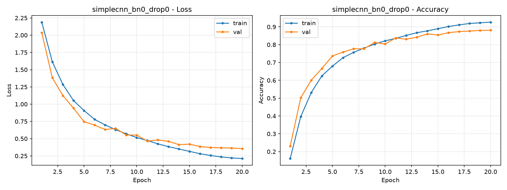
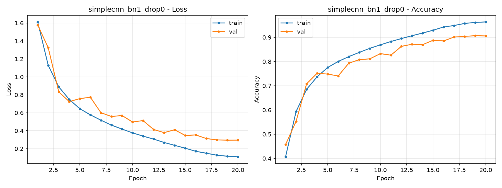
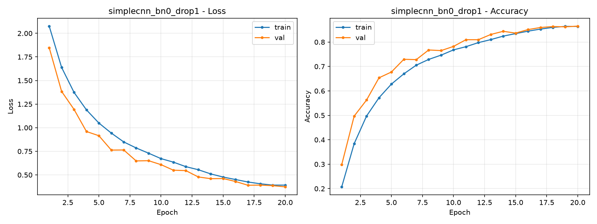
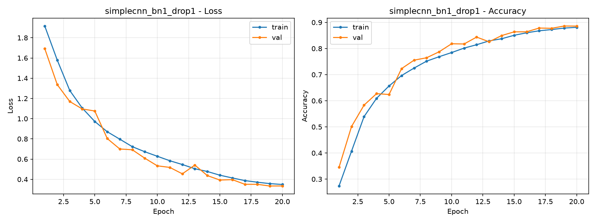
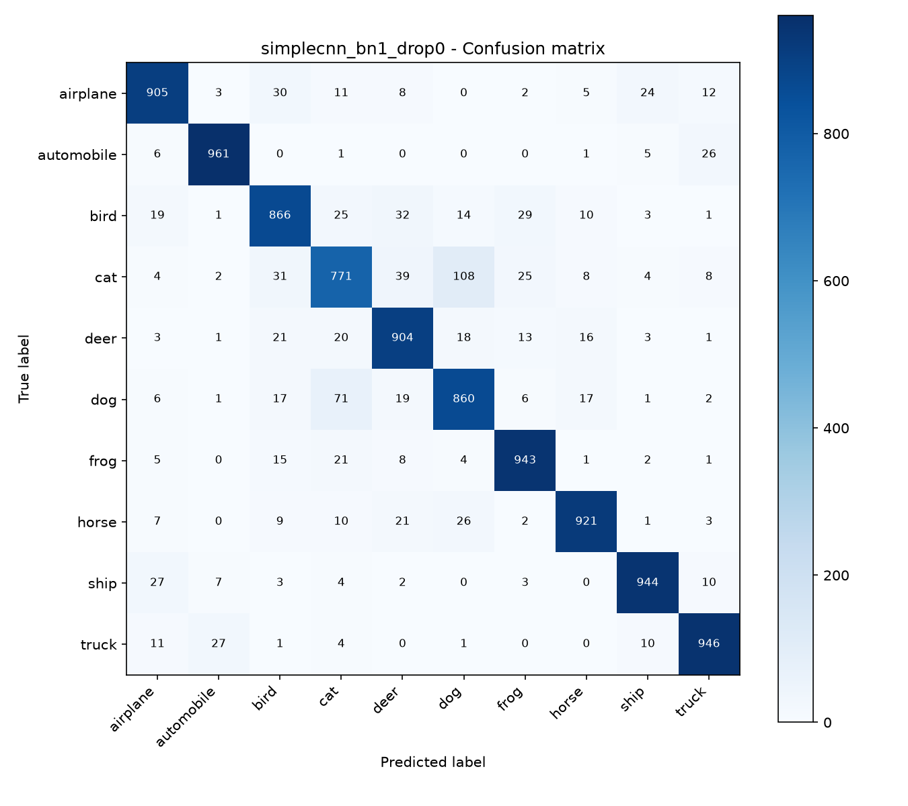
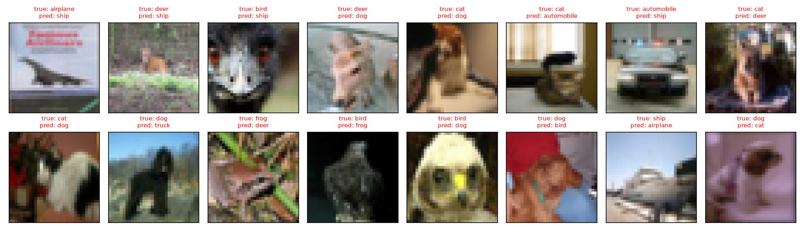

# 实验1 报告：基于 PyTorch 的图像分类

> 初步报告。所有数字来自 `exp1_image_classification/logs/`，图表来自 `exp1_image_classification/figures/`，未做人工修改。

姓名：__________　学号：__________　日期：2026-11-13

## 一、实验目的

1. 掌握 PyTorch 框架张量运算、数据集加载、数据增强、模型训练与验证的完整工程流程。
2. 理解卷积神经网络（CNN）的基本原理，能够针对图像分类任务选择网络结构、损失函数和优化器，完成模型搭建、训练与调优。
3. 掌握分类任务的评价指标，能够通过实验现象分析过拟合、欠拟合，并对实验结果进行评估分析。

## 二、实验环境

| 项目 | 配置 |
| --- | --- |
| 计算节点 | DGX Spark，NVIDIA GB10，121GB 统一内存 |
| 操作系统 | Ubuntu 24.04（ARM64） |
| Python | 3.12.3 |
| PyTorch | 2.14.1+cu130 |
| torchvision | 0.29.1+cu130 |
| 其他 | matplotlib 3.11.2、tqdm 4.70.1 |
| 随机种子 | 42（Python、NumPy、PyTorch、CUDA） |

## 三、数据集与预处理

使用 CIFAR-10 公开数据集：

- 共 60000 张 32×32 彩色图像，10 个类别：airplane、automobile、bird、cat、deer、dog、frog、horse、ship、truck。
- 官方训练集 50000 张按 9:1 划分为训练集 45000 张、验证集 5000 张；官方测试集 10000 张仅用于最终评估。
- 训练集预处理：`RandomCrop(32, padding=4)` + `RandomHorizontalFlip()` + `ToTensor()` + 按通道归一化（均值 `(0.4914, 0.4822, 0.4465)`，标准差 `(0.2470, 0.2435, 0.2616)`）。
- 验证集和测试集只做 `ToTensor()` + 同样的归一化，不做随机增强。

数据放在 `exp1_image_classification/data/`，由 `torchvision` 自动下载校验，不提交到 Git。

## 四、模型与训练设置

### 4.1 模型结构

采用 VGG 风格的轻量 CNN，输入 `3×32×32`，共 3 个卷积块：

- 每个卷积块包含两个 `3×3` 卷积（通道数依次为 64、128、256），每个卷积后可接 BatchNorm，再接 ReLU，最后经 `2×2` 最大池化。
- 三个卷积块后特征图尺寸为 `256×4×4`，展平后接全连接层 `4096 → 512 → 10`。
- 参数总量约 3.25M。

BatchNorm 和 Dropout 通过命令行开关控制：

- `--use-bn`：在每个卷积层后加入 BatchNorm2d（有 BN 时卷积不设偏置）。
- `--use-dropout`：在每个卷积块后和全连接层前加入 Dropout，`p=0.3`。

### 4.2 训练设置

| 参数 | 取值 |
| --- | --- |
| 损失函数 | CrossEntropyLoss |
| 优化器 | SGD（momentum 0.9，weight decay 5e-4） |
| 初始学习率 | 0.05，余弦退火 |
| batch size | 128 |
| 训练轮数 | 20 |
| 最优模型选择 | 验证集准确率最高的一轮 |

## 五、实验设计

保持数据、模型结构、优化器和训练轮数完全一致，只切换 BatchNorm 与 Dropout，做 4 组控制变量实验：

| 实验名 | BatchNorm | Dropout |
| --- | --- | --- |
| `simplecnn_bn0_drop0`（基准） | 否 | 否 |
| `simplecnn_bn1_drop0`（+BN） | 是 | 否 |
| `simplecnn_bn0_drop1`（+Dropout） | 否 | 是 |
| `simplecnn_bn1_drop1`（+BN+Dropout） | 是 | 是 |

评价指标：训练/验证 loss 与准确率曲线、测试集准确率与损失、各类别准确率、混淆矩阵、错例样本。

## 六、实验结果

### 6.1 四组对比

| 实验 | BN | Dropout | 最好验证准确率 | 最好轮次 | 测试准确率 | 测试损失 | 训练耗时 |
| --- | --- | --- | --- | --- | --- | --- | --- |
| 基准 | 否 | 否 | 88.14% | 20 | 87.82% | 0.3742 | 2 分 01 秒 |
| +BN | 是 | 否 | **90.68%** | 19 | **90.21%** | **0.3184** | 2 分 16 秒 |
| +Dropout | 否 | 是 | 86.52% | 20 | 86.65% | 0.3935 | 2 分 02 秒 |
| +BN+Dropout | 是 | 是 | 88.62% | 19 | 88.13% | 0.3545 | 2 分 19 秒 |

四组训练共约 8 分 38 秒，加上四组测试集评估，总耗时约 9 分钟。

### 6.2 训练曲线

基准（无 BN、无 Dropout）：



仅加 BatchNorm：



仅加 Dropout：



BatchNorm + Dropout：



## 七、结果分析

### 7.1 BatchNorm 的作用

- 测试准确率从 87.82% 提升到 90.21%，提高 **2.39 个百分点**；测试损失从 0.3742 降到 0.3184。
- 收敛明显更快：第 1 轮验证准确率基准为 23.14%，+BN 为 45.68%；第 5 轮两者接近（73.66% vs 74.82%），之后 BN 组持续领先。
- 前 10 轮验证准确率提升更快，之后持续领先；验证 loss 虽有波动，但整体低于基准。原因是 BN 对每层输入做标准化，缓解了参数更新导致的激活分布变化，使网络可以使用较大的初始学习率（0.05）并更快收敛。

### 7.2 Dropout 的作用

- 仅加 Dropout 的测试准确率为 86.65%，比基准低 **1.17 个百分点**；BN+Dropout 为 88.13%，比仅加 BN 低 **2.08 个百分点**。
- Dropout 组从第 5 轮起持续落后于基准：第 5 轮验证准确率 67.74%（基准 73.66%），第 10 轮 78.22%（基准 80.40%），第 15 轮 83.66%（基准 85.42%），第 20 轮 86.52%（基准 88.14%）。说明它拖慢了收敛，且在 20 轮内没有转化为更好的泛化。
- 在本实验设置下（45,000 张训练图、已有随机裁剪和翻转增强、仅训练 20 轮），基准模型的过拟合并不严重（训练准确率 92.64%，验证 88.14%，相差约 4.5 个百分点），Dropout 带来的正则化收益不足以抵消它拖慢收敛的代价。`p=0.3` 同时作用在 3 个卷积块和分类头，约束偏强，20 轮内模型尚未充分拟合。
- 需要注意：Dropout 组的训练准确率是在 Dropout 开启状态下统计的（`model.train()`），因此训练曲线偏低，不能直接与验证准确率比较；判断泛化能力应以验证/测试结果为准。

### 7.3 综合对比

- BatchNorm 是本实验中最有效的改进，单独使用即取得最高验证和测试准确率。
- Dropout 单独使用和与 BN 组合使用都没有超过基准，更没有超过仅加 BN 的配置。说明在本任务和当前训练预算下，Dropout 不是合适的正则化手段。
- 如果增加训练轮数、增大模型或减少数据增强强度，Dropout 的效果可能不同，本实验不能据此否定 Dropout 的一般作用。

## 八、混淆矩阵与错例分析

以测试准确率最高的 +BN 模型（90.21%）为例：



各类别测试准确率：

| 类别 | 准确率 | 类别 | 准确率 |
| --- | --- | --- | --- |
| airplane | 90.50% | frog | 94.30% |
| automobile | 96.10% | horse | 92.10% |
| bird | 86.60% | ship | 94.40% |
| cat | **77.10%** | truck | 94.60% |
| deer | 90.40% | dog | 86.00% |

最易混淆的类别对（真实 → 预测：数量）：

1. cat → dog：108 张
2. dog → cat：71 张
3. cat → deer：39 张
4. bird → deer：32 张
5. cat → bird：31 张

错例样本：



分析：

- **猫和狗是最难区分的两类**。猫的准确率只有 77.10%，大量猫被误判为狗；反过来狗也有 71 张被判成猫。两者在 32×32 分辨率下毛发纹理、体型和姿态相似，背景杂乱时更难区分。
- 猫还容易被判成鹿或鸟，说明模型对“小体型、四足、自然背景”这类整体形状敏感，但对细粒度特征（耳朵形状、脸部结构）区分不足。
- 基准模型也有相同的困难类别：dog → cat 107 张、cat → dog 89 张，另外还有 truck → automobile 45 张、ship → airplane 43 张。说明这些类别对本身相似度高，不是某一个模型配置的偶然问题。
- 从错例图可以看到，部分图片分辨率低、目标占比小、姿态不典型或存在遮挡，即使人来判断也有难度；32×32 输入丢失了大量细节，是错例的主要客观原因。
- 改进方向：使用更深的网络或迁移学习（如 ResNet18）、更高分辨率输入、针对易混类别做数据增强，或引入 label smoothing 等手段。

## 九、结论与局限

### 9.1 结论

1. 完成了 CIFAR-10 从数据加载、增强、训练、验证到测试评估的完整流程，四组实验均可复现。
2. BatchNorm 显著加快收敛并提升性能：测试准确率 87.82% → 90.21%（+2.39 个百分点），是本实验的最佳配置。
3. 在本实验的模型规模、数据量和 20 轮训练预算下，Dropout 反而使测试准确率下降（单独使用 86.65%，与 BN 组合 88.13%），说明正则化手段的效果依赖具体训练条件，不能盲目添加。
4. 类别层面的主要错误集中在猫/狗、猫/鹿、鸟/鹿等视觉相似的类别，低分辨率是重要客观限制。

### 9.2 局限

- 只使用了一个轻量 CNN 和单一随机种子，未做多次重复实验，绝对准确率可能有小幅波动。
- 只训练 20 轮，未系统搜索学习率、Dropout 概率等超参数。
- 未使用迁移学习，距离 CIFAR-10 上的先进结果仍有较大差距，但满足本实验“掌握流程、理解 CNN 和正则化作用”的目标。

## 十、复现方式

在 `exp1_image_classification/` 目录下：

```bash
source ~/venvs/cnn/bin/activate

# 四组训练（每组 20 轮，按配置自动命名）
python train.py
python train.py --use-bn
python train.py --use-dropout
python train.py --use-bn --use-dropout

# 测试集评估（可替换为任意一组权重）
python evaluate.py --checkpoint checkpoints/simplecnn_bn1_drop0.pth
```

输出位置：

- `logs/<实验名>.csv`：每轮训练/验证 loss、准确率、学习率
- `logs/<实验名>_config.json`：本次运行参数
- `logs/<实验名>_test.txt`：测试报告、各类别准确率、混淆矩阵
- `figures/<实验名>_curves.png`：loss/accuracy 曲线
- `figures/<实验名>_confusion_matrix.png`：混淆矩阵
- `figures/<实验名>_misclassified.png`：错例图
- `checkpoints/<实验名>.pth`：验证集最优模型（不进 Git）
