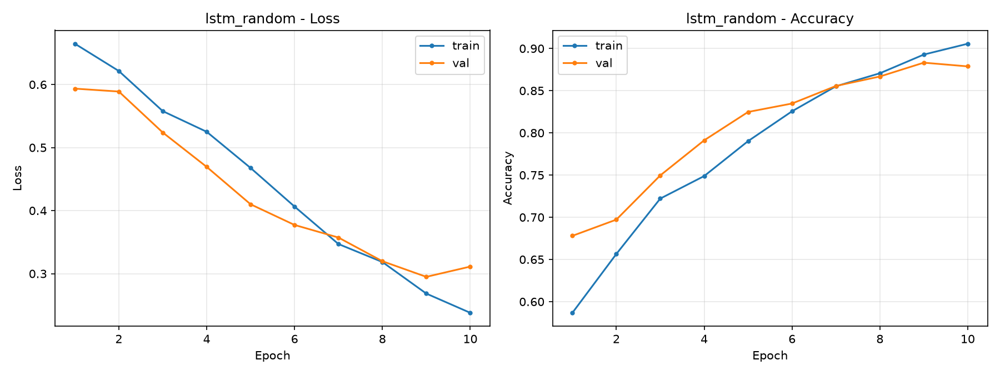
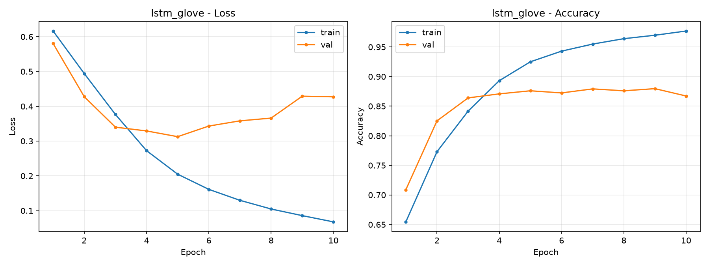
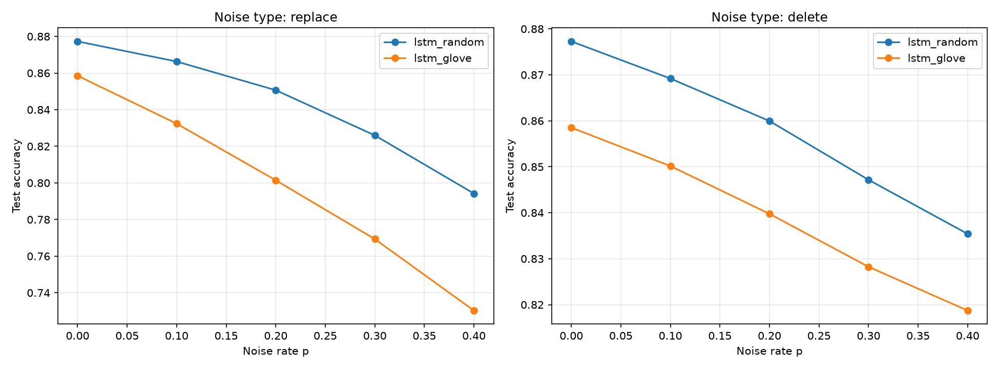

# 实验2 报告：基于 PyTorch 的文本情感分类

> 初步报告。所有数字来自 `exp2_text_sentiment/logs/`，图表来自 `exp2_text_sentiment/figures/`，未做人工修改。

姓名：__________　学号：__________　日期：2026-11-14

## 一、实验目的

1. 掌握自然语言文本处理的完整工程流程：文本清洗、分词、词表构建、序列数字化，掌握 Embedding 与循环网络的基础理论与代码实现。
2. 能够对文本类工程问题做特征建模，理解序列模型的数学逻辑，针对文本二分类任务选取可用的模型与评价方法。
3. 能够查阅技术文档，通过实验分析文本噪声、生僻词对模型预测结果带来的影响。

## 二、实验环境

| 项目 | 配置 |
| --- | --- |
| 计算节点 | DGX Spark，NVIDIA GB10，121GB 统一内存 |
| 操作系统 | Ubuntu 24.04（ARM64） |
| Python | 3.12.3 |
| PyTorch | 2.14.1+cu130 |
| 其他 | matplotlib 3.11.2、tqdm 4.70.1、numpy（随 torch 安装） |
| 随机种子 | 42（Python、NumPy、PyTorch、CUDA，噪声扰动同样由该种子派生） |

## 三、数据集与预处理

使用 IMDB 影评情感数据集（aclImdb_v1）：

- 训练集与测试集各 25000 条评论，正负各半；官方测试集只用于最终评估。
- 训练集内部按 9:1 切分为训练 22500 条、验证 2500 条（固定随机流），保证调参不接触测试集。
- 数据来源：斯坦福官方地址节点直连不通，经 hf-mirror 镜像下载 `aclImdb_v1.tar.gz`（84,125,825 字节，与官方完全一致），魔搭 `lemon3344s/imdb-fdu-for-lecture-2510` 留作备用源。

预处理流程（对应大纲"文本清洗、分词、构建词表、序列数字化"）：

1. **清洗**：去除 HTML 标签（aclImdb 原文含大量 `<br />`）；
2. **分词**：小写化后按正则 `[a-z0-9']+` 切词；
3. **词表**：只用训练集文本按词频构建，取词频 ≥ 2 的前 19998 个词，加 `<pad>`（id 0）与 `<unk>`（id 1）共 2 万；
4. **数字化**：词转 id，超长截断到 256 词，空序列以 `<unk>` 兜底；
5. **批处理**：变长序列按 batch 内最长补齐，配合 `pack_padded_sequence` 只计算有效长度，LSTM 取每个序列**真实最后时刻**的隐状态。

## 四、模型与训练设置

### 4.1 模型结构

```text
Embedding(20000 → 100, padding_idx=0)
  → Dropout(0.3)
  → LSTM(input 100, hidden 128, 1 层，取最后时刻隐状态)
  → Dropout(0.3)
  → Linear(128 → 2)
```

参数总量约 2.12M。两种词向量初始化方式（大纲拓展对比项）：

- `lstm_random`：Embedding 随机初始化（N(0,1) 由种子 42 派生）；
- `lstm_glove`：用 glove.6B.100d 初始化——词表 19998 个实词命中 19150 个，**命中率 95.75%**；未命中词与 `<unk>` 用全体命中向量的均值初始化，`<pad>` 置零；训练中不冻结、继续微调。

### 4.2 训练设置

| 参数 | 取值 |
| --- | --- |
| 损失函数 | CrossEntropyLoss |
| 优化器 | Adam（lr 1e-3，weight decay 1e-4） |
| 梯度裁剪 | max-norm 5.0（防 LSTM 梯度爆炸） |
| batch size | 64 |
| 训练轮数 | 10 |
| 最优模型选择 | 验证集准确率最高的一轮 |

## 五、实验设计

主对比保持数据、词表、网络结构、优化器与训练轮数完全一致，只切换 Embedding 初始化方式：

| 实验名 | Embedding 初始化 |
| --- | --- |
| `lstm_random` | 随机初始化 |
| `lstm_glove` | GloVe 预训练词向量 |

在此基础上增加两组量化分析：

1. **噪声鲁棒性实验**（对应大纲"分析文本噪声、生僻词对预测的影响"）：对测试集在 id 层面做两种扰动——`replace`（以概率 p 把词替换成词表内随机词，模拟噪声词/错别字入侵）与 `delete`（以概率 p 随机删词，模拟信息缺失），p ∈ {0, 0.1, 0.2, 0.3, 0.4}，每个条件用独立且可复现的随机流，测两个模型的准确率下降曲线。
2. **长度与生僻词分组分析**：把测试样本按"原始词数"和"`<unk>` 占比"分组统计准确率（不受截断影响）。

评价指标：训练/验证 loss 与准确率曲线、测试准确率与损失、混淆矩阵、分组准确率、高置信错例。

## 六、实验结果

### 6.1 主对比

| 实验 | 最好验证准确率 | 最好轮次 | 测试准确率 | 测试损失 | 训练耗时 |
| --- | --- | --- | --- | --- | --- |
| `lstm_random` | **88.32%** | 9 | **87.73%** | **0.2999** | 0.6 分钟 |
| `lstm_glove` | 87.96% | 9 | 85.85% | 0.4765 | 0.6 分钟 |

测试集 25000 条上的混淆矩阵（行 = 真实类别）：

| 模型 | neg → neg | neg → pos | pos → neg | pos → pos | 各类准确率 |
| --- | --- | --- | --- | --- | --- |
| random | 10860 | 1640 | 1428 | 11072 | neg 86.88% / pos 88.58% |
| glove | 10699 | 1801 | 1736 | 10764 | neg 85.59% / pos 86.11% |

### 6.2 训练曲线

随机初始化：



GloVe 初始化：



### 6.3 噪声鲁棒性

| 噪声强度 p | 删词-random | 删词-glove | 替换-random | 替换-glove |
| --- | --- | --- | --- | --- |
| 0.0 | 87.73% | 85.85% | 87.73% | 85.85% |
| 0.1 | 86.92% | 85.02% | 86.63% | 83.24% |
| 0.2 | 86.00% | 83.98% | 85.06% | 80.14% |
| 0.3 | 84.72% | 82.82% | 82.60% | 76.93% |
| 0.4 | 83.54% | 81.87% | 79.42% | 73.03% |



## 七、结果分析

### 7.1 收敛过程：GloVe 快，但快在"先到"，输在"过拟合"

逐轮验证准确率对比（来自 `logs/lstm_random.csv`、`logs/lstm_glove.csv`）：

| 轮次 | random | glove | 领先方 |
| --- | --- | --- | --- |
| 1 | 67.80% | 70.88% | glove +3.1 |
| 2 | 69.72% | **82.52%** | glove **+12.8** |
| 3 | 74.96% | 86.40% | glove +11.4 |
| 5 | 82.48% | 87.60% | glove +5.1 |
| 7 | 85.56% | 87.92% | glove +2.4 |
| 9 | **88.32%** | 87.96% | **random 反超** |

两条曲线的形状说明了全部问题：

- **前 5 轮 GloVe 大幅领先**（第 2 轮 +12.8pp）：预训练向量自带通用语义，相当于热启动，随机初始化模型还在从 N(0,1) 里"重新发明"词义。
- **但 GloVe 拟合训练集的速度同样快**：第 9 轮训练准确率已达 96.99%（random 仅 89.28%），同时**验证 loss 从第 5 轮的 0.313 一路回升到第 9 轮的 0.429**——典型的过拟合曲线；random 的验证 loss 一路降到第 9 轮的 0.295。
- 最终验证与测试双双反超，测试损失 0.30 对 0.48 同样印证：GloVe 的优势在收敛速度，劣势在泛化。

### 7.2 为什么随机初始化反而更好

在本实验设定下（2.25 万训练样本、全量微调、10 轮 Adam）：

1. **数据量足够**，从头学习一套"影评领域"的任务专属词向量并不困难；预训练向量带来的先验反而更快被消耗成对训练集的记忆。
2. GloVe 的几何来自 Wikipedia + Gigaword 通用语料，而影评中的极性表达（否定搭配、讽刺、领域词如 "B-movie"）需要大幅改写；微调过程既要适应任务又要保持预训练结构，两个目标在过拟合区间内互相牵制。
3. 这与 NLP 社区的常见经验一致：**预训练词向量的收益主要体现在数据量小或冻结向量不微调的场景**；数据充足且全量微调时优势消失甚至为负。本实验是该经验的一个具体例证。
4. 需要强调：GloVe 并非"没用"——若在第 4～5 轮就停（它第 4 轮验证 87.08%，random 第 4 轮只有 79.12%），GloVe 是明显的效率赢家。本实验的保存策略（按验证准确率峰值）让它把过拟合也"保存"了下来。

### 7.3 噪声鲁棒性：替换比删词伤，GloVe 模型对替换更脆弱

- **替换型噪声的伤害远大于删词**（p=0.4 时 random 降 8.3pp，删词只降 4.2pp）：删词只是信息变少，剩余词的顺序与语义不变，LSTM 的隐状态仍能聚合有效信号；替换则往句子里注入语义上完全无关的"合法词"，它们携带的向量会真实地写进每一步隐状态，扰动更本质。
- **GloVe 模型对替换噪声明显更脆弱**（-12.8pp 对 -8.3pp）。一种合理解释：它的判别更依赖"词的语义身份"——预训练向量在语义空间中有明确位置，随机词的语义与上下文剧烈冲突；而随机初始化模型对词的依赖更均匀，缺一块信息比"来一块错误信息"更容易被吸收。此为基于现象的机制推测，严格验证超出本实验范围。
- 两模型在 p=0.4 的替换下仍分别有 79.4% 和 73.0%，显著高于随机的 50%，说明 LSTM 情感分类对中等强度噪声有基本容错。
- 该实验把大纲"分析文本噪声、生僻词对模型预测的影响"从定性观察升级成了可复现的量化曲线（`logs/noise_results.csv`、`figures/noise_curves.png`）。

## 八、长文本与生僻词错例分析

### 8.1 长文本：截断是主要嫌疑

测试集评论平均 228 词、中位数 172 词、最长 2246 词，**27.9%（6980 条）超过 256 词的截断窗口**。

按原始词数分组的准确率（`lstm_random`，分组来自 `logs/lstm_random_buckets.csv`）：

| 词数区间 | 样本数 | 准确率 |
| --- | --- | --- |
| 0～562 | 23625 | 88.19% |
| 562～1123 | 1368 | 80.04% |
| 1123～1685 | 3 | 66.67% |
| 1685～2246 | 4 | 25.00% |

超长评论的准确率骤降 8～60 个百分点，两个叠加原因：一是 256 词截断直接丢掉了后面 60%～90% 的内容，而影评的情感转折常出现在结尾（"前两小时很好，但结局毁了整部电影"）；二是 LSTM 对长序列的记忆衰减。错例中确有此类样本：某条评论前段整段剧透式夸赞、结尾才给出差评，两个模型都以 0.99+ 的置信度判成了正面。

（注：1123 词以上两组分别只有 3 条和 4 条，数字波动大，只作方向性参考。）

### 8.2 生僻词：`<unk>` 占比越高准确率越低

按每条评论中未登录词（映射到 `<unk>`）的占比分组（`lstm_random`）：

| `<unk>` 占比 | 样本数 | 准确率 |
| --- | --- | --- |
| 0～6% | 22707 | 88.22% |
| 6～13% | 2208 | 82.74% |
| 13～19% | 79 | 87.34% |
| 19～26% | 6 | 66.67% |

主流趋势清晰：生僻词占比从 <6% 升到 6～13%，准确率下降 5.5 个百分点——未登录词的语义完全丢失，占比越高有效信息越少。（13～19% 桶只有 79 条、19～26% 只有 6 条，样本过少导致波动，不改变主趋势。）这与 7.3 的替换实验互为印证：天然生僻词（OOV）与人工噪声词都以不同方式破坏词级信息。

### 8.3 高置信错例：讽刺与混合情感

置信度最高的错例（`logs/lstm_random_test.txt`、`logs/lstm_glove_test.txt`）高度集中在一类：**字面全是褒义词的反讽差评**。例如：

> "Masterpiece. Carrot Top blows the screen away. Never has one movie captured the essence of the human spirit quite like 'Chairman of the Board.' 10/10... don't miss this instant classic."（真实 negative，glove 以 0.9999 判正）

> "This movie was pure genius. John Waters is brilliant. It is hilarious and I am not sick of it even after seeing it about 20 times..."（真实 negative，random 以 0.9989 判正）

这类评论每个局部词块都是强正面信号，需要理解"夸得越离谱越可能是骂"才能翻转，而词级 LSTM 恰恰按词面信息聚合，天然吃亏。另一类是前褒后贬的混合情感（如 "I must say I was disappointed... Although it is well acted and directed..."），转折词的影响力被长距离稀释。两个模型的错例高度重合（很多是同一条评论），说明这些是任务本身的难点而非某一配置的偶然问题。

## 九、结论与局限

### 9.1 结论

1. 完成了从清洗、分词、词表构建到 Embedding+LSTM 训练与评估的完整流程，全部实验可复现。
2. 大纲拓展对比项的结果：**随机初始化（测试 87.73%）优于 GloVe 预训练初始化（85.85%）**。GloVe 带来显著更快的收敛（前 5 轮领先 5～13pp），但在数据充足、全量微调的设定下更早过拟合，最终泛化更差；预训练词向量的价值场景是"小数据或冻结向量"。
3. 噪声实验给出量化结论：替换型噪声的伤害大于删词（p=0.4 时 -8.3pp 对 -4.2pp），且依赖预训练语义的模型对替换噪声更脆弱（-12.8pp）。
4. 错误集中在四类：讽刺反语、前褒后贬的混合情感、超长评论被截断（占测试集 27.9%）、高生僻词占比。

### 9.2 局限

- 只用单随机种子，未做多次重复实验，绝对数值允许小幅波动。
- 最优模型按验证**准确率**峰值保存，未按验证 loss 早停；GloVe 组的过拟合段被保存了下来，若早停其排名可能改善——这是后续可以补的实验。
- 词表 2 万、截断 256、LSTM 单层单向均未调参；未尝试 BiLSTM、attention、更长的截断窗口或动态 padding 上限。
- GloVe 只试了 6B.100d 微调一种用法，冻结词向量、300 维、840B 大语料均未覆盖。
- 噪声实验的机制解释（7.3）是基于现象的推测，未做控制变量验证。

## 十、复现方式

在 `exp2_text_sentiment/` 目录下（数据下载方法见该目录 `README.md`）：

```bash
source ~/venvs/cnn/bin/activate

# 两组主对比（各 10 轮，GB10 上每组约 36 秒）
python train.py --embedding-init random
python train.py --embedding-init glove

# 测试集评估（混淆矩阵、长度/生僻词分组、错例）
python evaluate.py --checkpoint checkpoints/lstm_random.pth
python evaluate.py --checkpoint checkpoints/lstm_glove.pth

# 噪声鲁棒性实验
python noise_test.py --checkpoints checkpoints/lstm_random.pth checkpoints/lstm_glove.pth
```

## 参考资料

1. Maas, A. L. 等. *Learning Word Vectors for Sentiment Analysis*. ACL 2011.（IMDB/aclImdb 数据集）
2. Pennington, J., Socher, R., Manning, C. D. *GloVe: Global Vectors for Word Representation*. EMNLP 2014.（glove.6B 词向量）
3. 伊莱·史蒂文斯. 《PyTorch 深度学习实战》. 人民邮电出版社, 2022.（课程教材）
4. 数据下载：aclImdb_v1 与 glove.6B 经 hf-mirror.com 镜像获取（节点直连斯坦福/GitHub 不通），镜像文件与官方字节数一致。
