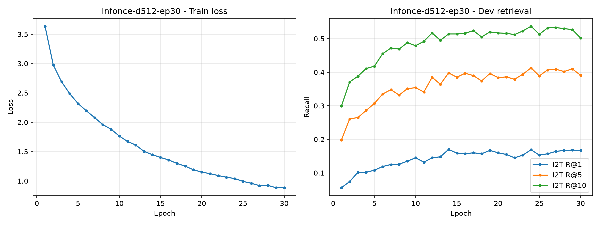
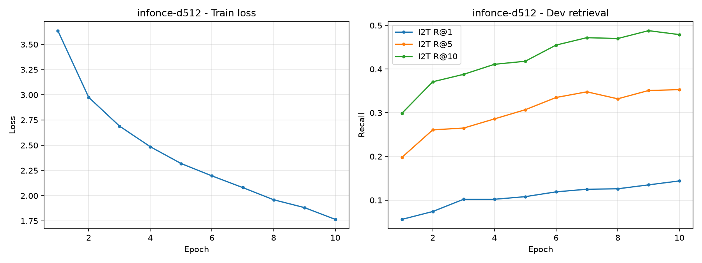
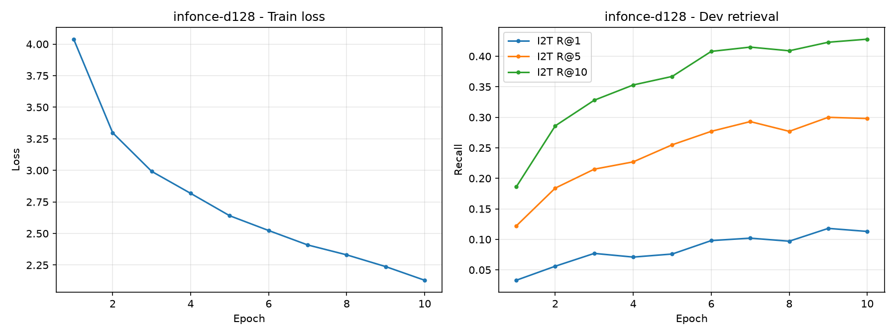
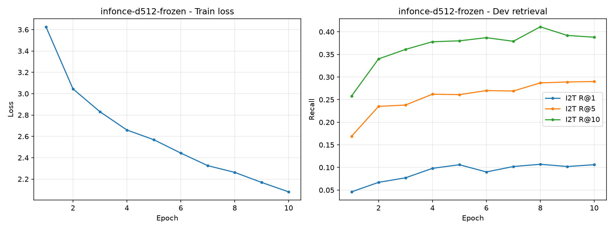
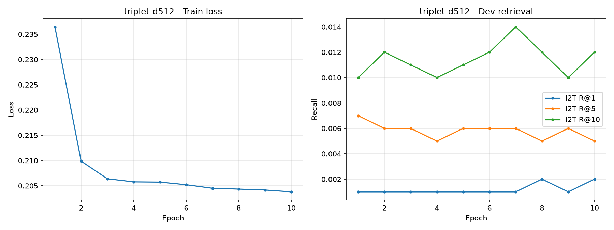
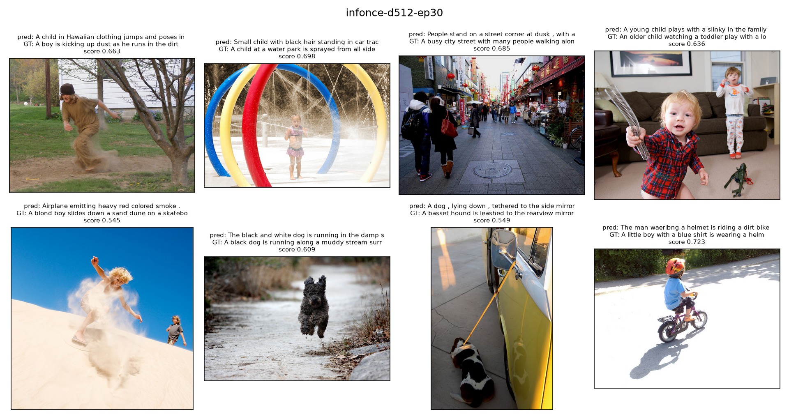

# 实验3 报告：图像与文本多模态检索

> 初步报告。所有数字来自 `exp3_image_text_retrieval/logs/` 下的 CSV、配置、测试报告和排名统计，图表来自 `exp3_image_text_retrieval/figures/`，未做人工修改；定性错例为对检索示例图中样本的逐条人工分析。

姓名：__________　学号：__________　日期：2026-11-19

## 一、实验目的

1. 综合运用计算机视觉、自然语言处理知识，掌握多模态特征提取、特征融合的工程实现方法。
2. 理解迁移学习思想，学会查阅预训练模型技术文档，针对跨模态匹配工程问题选择可用模型方案。
3. 能够分析不同模态特征分布差异，理解相似度计算的数学表达，对模型匹配误差开展分析。

## 二、实验环境

| 项目 | 配置 |
| --- | --- |
| 计算节点 | DGX Spark，NVIDIA GB10，121GB 统一内存 |
| 操作系统 | Ubuntu 24.04（ARM64） |
| Python | 3.12.3 |
| PyTorch | 2.14.1+cu130 |
| torchvision | 0.29.1+cu130 |
| 其他 | transformers 4.57.6、matplotlib 3.11.2、tqdm 4.70.1 |
| 随机种子 | 42（Python、NumPy、PyTorch、CUDA，`cudnn.deterministic`） |

版本为共享训练环境（`~/venvs/cnn`）实测值。

## 三、数据集与预处理

使用 Flickr8k 图文配对数据集（Hodosh, Young, Hockenmaier, *Framing Image Description as a Ranking Task*, JAIR 2013）：

- 8091 张日常场景图片，每张 5 条英文描述；按官方划分使用 6000/1000/1000 张作训练/验证/测试。
- 训练前做了数据审计：全部 8091 张图可正常打开；官方划分内 8000 张图均有 5 条描述；`Flickr8k.token.txt` 中的坏文件名 `2258277193_586949ec62.jpg.1`（磁盘无对应图片）读取时跳过；图像尺寸共 597 种，最常见为 500×333 和 500×375。
- 描述平均 10.8 词，中位数 10，P95 为 18，最长 37 词；描述词表 8493。

预处理分两路：

- **图像**：`Resize(256)` → `CenterCrop(224)` → `ToTensor` → ImageNet 均值/方差归一化，喂给冻结的 ResNet18 提取 512 维特征；训练前对全部图片一次性预计算（train 5.6 秒、dev/test 各 1.0 秒），训练和评估直接读特征缓存。
- **文本**：BERT tokenizer 分词，最大长度 48 token，超长截断、不足补 padding；编码时按 `attention_mask` 做 mean pooling。

## 四、模型与训练设置

### 4.1 模型结构

双塔结构，两路特征投影到共享嵌入空间后做余弦相似度：

```text
图像: 冻结 ResNet18 (512d) -> Linear -> GELU -> Dropout -> Linear -> 512d -> L2 归一化
文本: BERT-tiny (L=2, H=128, 4.39M, mean pooling) -> 同结构投影头 -> 512d -> L2 归一化
```

- 图像塔完全冻结：ResNet18 是 ImageNet 预训练权重（`IMAGENET1K_V1`），特征离线预计算，不参与反向传播。这符合大纲"调用预训练 CNN 模型提取图像特征"的要求，也让对比实验便宜（每 epoch 约 1 秒）。
- 文本塔默认微调 BERT-tiny（`google/bert_uncased_L-2_H-128_A-2`），另设 `--freeze-text` 冻结分支作对比。
- 投影头为两层 MLP（`Linear → GELU → Dropout(0.1) → Linear`），嵌入维度是实验变量。
- 全模型可训练参数 5,239,936（约 5.24M，见 `logs/infonce-d512-ep30_config.json`）。

### 4.2 训练设置（最佳配置）

| 参数 | 取值 |
| --- | --- |
| 损失函数 | 对称 InfoNCE，temperature 0.07 |
| 优化器 | Adam，weight decay 1e-4，梯度裁剪 1.0 |
| 学习率 | 投影头 1e-3，BERT 1e-4 |
| batch size | 128 |
| 训练轮数 | 30（基线与对比组 10） |
| 描述采样 | 每 epoch 为每张图随机抽 1 条，batch 内其他图的描述作负样本 |
| 最优模型选择 | 验证集 I2T R@1 最高的一轮 |

每张图有 5 条描述，若不处理会把同一张图的描述互相当成负样本；实现上按图片组织 batch，负样本只来自其他图片。

## 五、实验设计

以 `InfoNCE + 256 维 + 10 epoch` 的基线为参照，做四组控制变量实验，共 8 次训练：

| 变量 | 组 | 其余设置 |
| --- | --- | --- |
| 嵌入维度 | d128 / d256（基线）/ d512 | InfoNCE，10 epoch |
| 训练轮数 | d512 跑 30 epoch | 其余同基线口径 |
| 损失函数 | triplet（d256、d512），batch-hard，margin 0.2 | 10 epoch |
| triplet 诊断 | d512 + lr×5 + 30 epoch | 确认非学习率问题 |
| 文本编码器 | d512 冻结 BERT | 与微调 d512 对照 |

评价指标：图像→文本（I2T）与文本→图像（T2I）的 Recall@1/5/10 和中位排名。候选池为测试集全部 1000 张图 / 5000 条描述；一张图有 5 条正确描述，任意一条进入 top-K 即算命中。

## 六、实验结果

| 实验 | dev I2T R@1（最优轮） | test I2T R@1/5/10 | test T2I R@1/5/10 | 训练耗时 |
| --- | --- | --- | --- | --- |
| `baseline-infonce-d256`（10 epoch） | 13.80%（epoch 8） | 12.30 / 33.30 / 47.70% | 10.18 / 30.06 / 43.78% | 10.6 秒 |
| `infonce-d128`（10 epoch） | 11.80%（epoch 9） | 11.30 / 32.10 / 45.40% | 9.08 / 28.42 / 41.22% | 9.2 秒 |
| `infonce-d512`（10 epoch） | 14.40%（epoch 10） | 16.20 / 35.80 / 48.10% | 11.42 / 33.36 / 46.64% | 12.7 秒 |
| `infonce-d512-ep30`（30 epoch） | **17.00%（epoch 14）** | **17.70 / 38.10 / 51.30%** | **12.00 / 34.40 / 48.24%** | 28.4 秒 |
| `infonce-d512-frozen`（10 epoch） | 10.70%（epoch 8） | 9.60 / 29.60 / 40.50% | 7.96 / 24.42 / 36.52% | 9.5 秒 |
| `triplet-d256`（10 epoch） | 0.40%（epoch 6） | 0.30 / 0.90 / 1.50% | 0.10 / 0.66 / 1.20% | 9.6 秒 |
| `triplet-d512`（10 epoch） | 0.20%（epoch 8） | 0.10 / 0.50 / 1.60% | 0.10 / 0.66 / 1.12% | 9.7 秒 |
| `triplet-d512-lrx5`（30 epoch，lr×5） | 0.30%（epoch 5） | 0.20 / 0.70 / 0.80% | 0.10 / 0.52 / 1.00% | 27.8 秒 |

最佳配置（d512，30 epoch）测试集 I2T 中位排名 10、T2I 中位排名 11；基线（10 epoch）分别为 12 和 14。

训练曲线（dev I2T R@1 与损失）：









triplet 收敛失败组的曲线（train_loss 长期平坦）：



## 七、结果分析

### 7.1 嵌入维度

- 同口径（InfoNCE、10 epoch）下 512 维明显最好：test I2T R@1 16.20%，比 256 维基线高 3.90 个百分点，比 128 维高 4.90 个百分点。
- 128 维反而比 256 维差，说明共享嵌入空间的容量是瓶颈：图文两路都要把各自的模态信息压缩进同一空间，维度太小丢掉的信息比对检索有用的多。
- d512 在 10 epoch 时最优轮落在第 10 轮（dev R@1 仍在上升），未到平台；延长到 30 epoch 后最优轮为 14，test R@1 再升 1.50 个百分点到 17.70%。每 epoch 约 1 秒，加长成本极低。

### 7.2 损失函数：InfoNCE 与 batch-hard 三元组

- InfoNCE 正常收敛，而 batch-hard 三元组损失在本设置下**完全无法收敛**：三组（d256、d512、lr×5+30 epoch）的 test R@1 全部 ≤ 0.3%，与随机检索相当（候选池 5000 条、每图 5 条真值时随机 R@1 约 0.1%）；中位排名 550–800，虽好于随机的 2500，但与正常训练的 10 相差 50 倍以上。
- 从训练曲线看，triplet 的 train_loss 从 0.236 缓慢降到 0.204 后长期不动——损失形式为 `relu(margin − pos + hardest_neg)`，0.204 恰好卡在 margin 尺度附近，即最难负样本的相似度始终比正确配对高约 0.1，margin 从未被满足。
- 根本原因是**温度缩放的缺失**。InfoNCE 把余弦相似度除以 temperature 0.07，等效把相似度差放大约 14 倍，且交叉熵天然聚焦 batch 内最难负样本；triplet 直接用原始余弦相似度，初始时两路嵌入（冻结的 ImageNet 特征投影、未经适配的 BERT mean pooling）都挤在归一化球面的同一窄锥里，梯度信号弱，即使学习率×5、训练 30 轮也拉不开。
- 结论：余弦空间上做对比学习，温度缩放不是可省略的超参数，而是收敛的必要条件。

### 7.3 冻结 vs 微调 BERT

- 同口径（d512、10 epoch）下微调 16.20%、冻结 9.60%，微调高 6.60 个百分点。
- 冻结时文本塔只能靠两层 MLP 把 BERT 原始句向量变换到与 ResNet18 特征对齐的空间，适配能力有限；微调让 BERT 的词表示本身向检索目标靠拢。小数据（6000 图）下微调 tiny 模型（4.39M 参数）没有过拟合风险，收益明显。

## 八、检索误差分析

以最佳模型（`infonce-d512-ep30`）为对象，先定量后定性。

### 8.1 真值排名分布（定量）

对 1000 张测试图的 I2T 检索，5 条真值描述中最好排名的分布：

| 真值排名 | 数量 | 占比 | 累计 |
| --- | --- | --- | --- |
| 1 | 177 | 17.7% | 17.7% |
| 2–5 | 204 | 20.4% | 38.1% |
| 6–10 | 132 | 13.2% | 51.3% |
| 11–50 | 272 | 27.2% | 78.5% |
| 51–200 | 158 | 15.8% | 94.3% |
| 201–5000 | 57 | 5.7% | 100% |

- top1 失败的 823 张中，**40.8% 的真值仍在 top10 内**，排名 100 开外（完全错配）只占失败的 16.0%。
- 失败样本中 top1 与最佳真值的相似度差中位数仅 0.085，31.3% 的失败样本差值小于 0.05。

说明大部分错误是**"近失败"**——检索结果语义接近但排序差一口气，而不是完全无关；模型的排序分辨力是当前主要短板。

### 8.2 检索示例分析（定性）



对示例图中 8 个随机样本逐条看图分析（pred 为检索 top1 描述，GT 为该图任一条真值）：

1. **土路上跑动的男孩**：pred 是"Hawaiian 服装的小孩跳跃摆姿势"，GT 是"男孩在土里跑动扬起灰尘"。场景主题（户外土路、小孩）检索对了，但动作（跑 vs 跳）和服装（棕色衣服戴帽 vs Hawaiian 服装）都不对——匹配到了另一张场景相似图片的描述。属细粒度动作/外观区分不足。
2. **喷水圈里的小孩**：pred 是"向日葵/赛道旁的小孩"，完全错配。图中"彩色圆环+水雾+小孩"的组合概念在训练分布里少见，模型没学到。
3. **商业街人群**：pred "人们黄昏站在街角"与 GT "繁忙的城市街道很多人在走"语义高度接近，只因措辞不同未命中。属近失败，与 8.1 的定量结论一致。
4. **两个小孩玩弹簧玩具**：pred 只描述"一个小孩玩 slinky"（图中确实存在），漏掉了 GT 强调的"大的看着小的玩"的两人关系。组合关系（谁在看谁）在单一余弦相似度里表达不足。
5. **沙丘滑板的男孩**：pred 是"飞机排放红色浓烟"——白沙扬起的雾与烟雾在视觉上相似，把检索带偏到完全不同的场景。视觉歧义导致的跨模态错位。
6. **溪流边的黑狗**：pred "黑白花狗在潮湿溪流里跑"，GT "黑狗沿着泥泞溪流跑"。动作场景全对，只有颜色属性错（狗是纯黑的）。近失败。
7. **拴在后视镜上的狗**：pred "狗趴着拴在后视镜上"与 GT "巴吉度猎犬拴在后视镜上"几乎同义，但品种（basset hound）退化成了 dog，措辞差异又导致未命中。
8. **骑小自行车的男孩**：pred "戴头盔的男人骑越野摩托"，GT "穿蓝衣服的小男孩戴头盔"。头盔、骑车等要素都对，但把小孩看成男人、把童车看成越野摩托——年龄与物体尺度判断错误。

### 8.3 失败模式归纳

1. **近失败占主导**（40.8% 的失败真值在 top10 内）：描述间语义相近时排序不稳，需要更强的细粒度对齐或重排序手段。
2. **细粒度属性错误**：年龄、颜色、服装、品种等属性级差异分辨不足，与 BERT-tiny（4.39M）的语义容量和 6000 张训练图的规模有关。
3. **视觉歧义与罕见组合**：烟雾/水雾等视觉相似模式、以及"彩色喷水圈"这类罕见组合会把检索带向完全错误的描述。
4. **组合关系表达不足**：多主体间的动作关系（"看着…玩"）在单一全局余弦相似度里被弱化。

改进方向：换更大的文本编码器（如 BERT-base）、加入难度更高的负样本挖掘或重排序（用大模型对 top-K 重排）、提高文本侧输入分辨率（当前 max_len 48 已覆盖 P95=18 的描述长度，非瓶颈）、或对罕见场景增广。

## 九、结论与局限

### 9.1 结论

1. 完成了 Flickr8k 上"预训练 CNN 提图像特征 + 预训练 BERT 提文本特征 + 双塔投影 + 余弦相似度检索"的完整流程，8 组实验全部可复现（固定种子 42，单组训练 10–30 秒）。
2. 嵌入维度 512 + 30 epoch 为最佳配置：test I2T R@1 17.70%、R@10 51.30%，比 256 维 10 epoch 基线高 5.40 个百分点。
3. 损失函数对比表明：温度缩放的 InfoNCE 稳定收敛，原始余弦空间 + margin 0.2 的 batch-hard 三元组完全无法收敛（三组验证，含学习率×5 诊断组）——温度缩放是该任务收敛的必要条件。
4. 微调 BERT 比冻结高 6.60 个百分点，小数据下微调小模型是划算的。
5. 误差分析显示约四成失败是近失败（真值仍在 top10），主要短板是细粒度属性与组合关系的排序分辨力。

### 9.2 局限

- 文本编码器只有 4.39M 参数的 BERT-tiny，检索绝对指标距离 Flickr8k 上更大的模型（R@1 普遍 30%+）有明显差距；本实验重点是流程与对比分析而非刷指标。
- triplet 损失只试了 margin 0.2、两种学习率，未系统调参（如更小 margin、损失加权）；结论限于该设置。
- 图像塔完全冻结，未实验微调 ResNet18 末层或换更强视觉骨干。
- 单一随机种子，未做多次重复实验，指标可能有小幅波动。

## 十、复现方式

在 `exp3_image_text_retrieval/` 目录下：

```bash
source ~/venvs/cnn/bin/activate

# 1. 预计算冻结 ResNet18 特征（只需一次，约 8 秒）
python precompute_features.py

# 2. 最佳配置（30 epoch，约 28 秒）
python train.py --loss infonce --embed-dim 512 --epochs 30 --run-name infonce-d512-ep30

# 3. 测试集评估
python evaluate.py --checkpoint checkpoints/infonce-d512-ep30.pth --split test

# 4. 其余对比组（命令与 run_name 见 README「怎么跑」节）
```

输出位置：

- `logs/<实验名>.csv`：每轮 dev 检索指标
- `logs/<实验名>_config.json`：本次运行完整参数与参数量
- `logs/<实验名>_test.txt`：测试集检索指标报告
- `logs/<实验名>_test_examples.csv`：随机样本的 top1 检索结果与真值对照
- `figures/<实验名>_curves.png`：dev 指标与损失曲线
- `figures/<实验名>_test_examples.png`：检索示例图
- `checkpoints/<实验名>.pth`：验证集最优模型（不进 Git）
